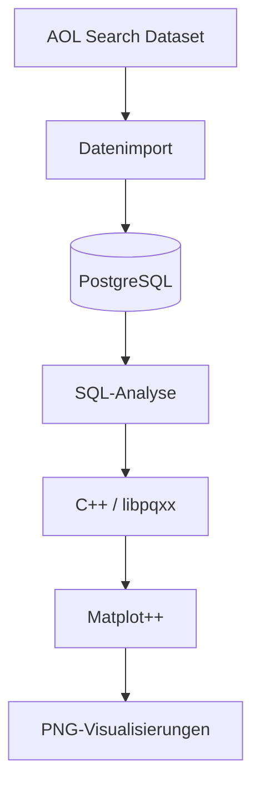

# AOL Database – Analysis & Visualization


## Über das Projekt

Dieses Projekt entstand im Rahmen einer universitären
Aufgabenstellung im Bereich Datenbanken und Datenanalyse.

Ziel ist die systematische Untersuchung historischer
AOL-Suchanfragen aus dem Jahr 2006 im Zusammenhang
mit dem Irakkrieg.

Mithilfe relationaler Datenbankmodelle, SQL-Abfragen
und einer eigens entwickelten C++-Anwendung werden
Suchmuster identifiziert, statistisch ausgewertet
und grafisch visualisiert.

Das Projekt verbindet Datenbankmanagement,
Datenanalyse und Softwareentwicklung.

## Inhaltsverzeichnis

- [Forschungsfrage](#forschungsfrage)
- [Funktionen](#funktionen)
- [Technologien](#technologien)
- [Architektur](#architektur)
- [Projektstruktur](#projektstruktur)
- [Datenbankmodell](#datenbankmodell)
- [Visualisierungen](#visualisierungen)
- [Installation](#installation)
- [Verwendung](#verwendung)
- [Datenschutz und Datenqualität](#datenschutz-und-datenqualität)
- [Erweiterungsmöglichkeiten](#erweiterungsmöglichkeiten)
- [Autor](#autor)

## Forschungsfrage

Welche thematischen und zeitlichen Suchmuster lassen
sich in den AOL-Suchanfragen im Zusammenhang mit
dem Irakkrieg identifizieren?

Dabei werden insbesondere folgende Aspekte untersucht:

- Häufigkeit relevanter Suchbegriffe
- Zeitliche Entwicklung des Suchinteresses
- Erwähnungen politischer Akteure und Organisationen
- Suchanfragen im Zusammenhang mit Krieg und Waffen
- Suchverhalten hinsichtlich Veteranen und Hilfsangeboten
- Geografische Zusammenhänge zwischen Suchbegriffen
- Gemeinsames Auftreten verschiedener Themen

## Funktionen

- Import und Verarbeitung historischer Suchanfragen
- Relationale Datenbankmodellierung
- Schlüsselwortbasierte Themenklassifizierung
- Textanalyse mittels regulärer Ausdrücke
- Statistische Auswertung durch SQL-Abfragen
- PostgreSQL-Anbindung über C++
- Automatisierte Erstellung von Diagrammen
- Export der Visualisierungen als PNG-Dateien

## Technologien

| Technologie | Verwendungszweck |
|---|---|
| C++ | Anwendungslogik und Visualisierung |
| PostgreSQL | Datenhaltung und Datenverarbeitung |
| SQL | Abfragen und statistische Auswertungen |
| libpqxx | PostgreSQL-Anbindung in C++ |
| Matplot++ | Erstellung von Diagrammen |
| CMake | Vorgesehenes Build-System |
| Git | Versionsverwaltung |

## Architektur



Die Anwendung unterteilt sich in drei zentrale Bereiche:

1. **Datenhaltung:** Speicherung der Suchanfragen
   und Definition relationaler Datenstrukturen.

2. **Datenanalyse:** Filterung, Klassifizierung
   und Aggregation der Daten mittels SQL.

3. **Visualisierung:** Verarbeitung der Abfrageergebnisse
   und Erstellung von Diagrammen mithilfe von C++
   und Matplot++.

## Projektstruktur

```text
AOLDatabase-Visualisierung/
|
|-- DBImport.sql       # Import der AOL-Rohdaten
|-- TablesDB.sql       # Relationales Datenbankschema
|-- Processing.sql     # Verarbeitung und Klassifizierung
|-- keyword.sql        # Erweiterte Schlüsselwortdefinitionen
|-- queries.sql        # SQL-Abfragen zur Datenanalyse
|
|-- main.cpp           # Einstiegspunkt der Anwendung
|-- plots.cpp          # Implementierung der Visualisierungen
|-- plots.hpp          # Deklaration der Plot-Funktionen
|
`-- README.md          # Projektdokumentation
```

## Datenbankmodell

Das relationale Datenbankmodell bildet Suchanfragen,
Benutzerkategorien, Suchergebnisse, Schlüsselwörter
und politische Akteure ab.

| Tabelle | Beschreibung |
|---|---|
| `aol_raw` | Importierte AOL-Rohdaten |
| `users` | Benutzerkategorien |
| `search_query` | Modellierte Suchanfragen |
| `click` | Angeklickte Suchergebnisse |
| `keyword` | Schlüsselwörter und Themenkategorien |
| `actor` | Politische Akteure und Organisationen |
| `query_keyword` | Zuordnung von Suchanfragen zu Schlüsselwörtern |
| `query_actor` | Zuordnung von Suchanfragen zu Akteuren |

Die analytischen SQL-Abfragen greifen insbesondere
auf die importierten Rohdaten und die definierten
Schlüsselwortkategorien zurück.

## Visualisierungen

Die C++-Anwendung unterstützt verschiedene
statistische Auswertungen und Diagramme.

| Analyse | Beschreibung |
|---|---|
| IED Search Analysis | Häufigkeit und zeitliche Entwicklung entsprechender Suchanfragen |
| Political Actors | Erwähnungen politischer Persönlichkeiten |
| Topic Distribution | Verteilung relevanter Themengebiete |
| Actor Analysis | Häufigkeit verschiedener Akteure |
| Veteran Analysis | Suchanfragen zu Veteranen und Hilfsangeboten |
| Iraq War Analysis | Zusammenhang zwischen Irak- und Kriegssuchanfragen |
| WMD Analysis | Suchinteresse an Massenvernichtungswaffen |
| Geographic Analysis | Zeitliche Entwicklung ortsbezogener Suchanfragen |
| Geographic Correlation | Gemeinsame Nennung irakischer und internationaler Orte |

Die Ergebnisse werden unter anderem als Balken-,
Linien- und Kreisdiagramme dargestellt.

Die generierten Diagramme können als PNG-Dateien
gespeichert und für weiterführende Analysen
verwendet werden.

## Installation

### Voraussetzungen

- C++-Compiler, beispielsweise GCC oder Clang
- PostgreSQL
- CMake
- [libpqxx](https://github.com/jtv/libpqxx)
- [Matplot++](https://github.com/alandefreitas/matplotplusplus)
- Gnuplot

### 1. Repository klonen

```bash
git clone https://github.com/Sveppg/AOLDatabase-Visualisierung.git
cd AOLDatabase-Visualisierung
```

### 2. Abhängigkeiten installieren

Unter Debian- und Ubuntu-basierten Systemen:

```bash
sudo apt update
sudo apt install build-essential cmake git \
    postgresql libpq-dev libpqxx-dev gnuplot
```

Matplot++ muss entsprechend der offiziellen
Installationsanleitung eingerichtet werden.

### 3. Datenbank vorbereiten

Eine PostgreSQL-Datenbank für das Projekt erstellen:

```bash
createdb aol_database
```

Die SQL-Skripte dienen anschließend zur Einrichtung
des Datenbankschemas, zum Datenimport und zur Analyse.

Empfohlene Reihenfolge:

1. `TablesDB.sql` – Datenbankschema erstellen.
2. `DBImport.sql` – AOL-Rohdaten importieren.
3. `Processing.sql` – Schlüsselwörter und Akteure verarbeiten.
4. `queries.sql` – Analytische Abfragen ausführen.

Die Dateipfade innerhalb von `DBImport.sql` müssen
an die lokale Umgebung angepasst werden.

`keyword.sql` enthält eine alternative bzw. erweiterte
Schlüsselwortliste. Überschneidungen mit `Processing.sql`
müssen vor der Ausführung berücksichtigt werden.

### 4. Datenbankverbindung konfigurieren

Die Datenbankverbindung wird über die Funktion
`make_db()` hergestellt.

Hierfür muss eine entsprechende `db.hpp` bereitgestellt
und mit den lokalen Verbindungsdaten konfiguriert werden.

Zugangsdaten sollten nicht direkt im Quellcode oder
im öffentlichen Repository gespeichert werden.

### Aktueller Entwicklungsstand

Der aktuelle Repository-Stand enthält noch keine
vollständige CMake-Konfiguration und keine `db.hpp`.

Diese Dateien müssen für einen eigenständigen Build
ergänzt werden.

## Verwendung

Die gewünschten Visualisierungen können innerhalb
der `main.cpp` aktiviert werden.

Beispiel:

```cpp
#include "plots.hpp"

int main() {
    plot01_ied_per_month();
    plot02_politicians_iraq_bar();
    plot05_veteran_pie();
    plot06_iraq_war();

    plot_iraq_city_over_time("baghdad");

    plot10_iraq_world_pairs_top10();

    return 0;
}
```

Nach erfolgreicher Kompilierung und Ausführung
werden die entsprechenden Diagramme im aktuellen
Arbeitsverzeichnis als PNG-Dateien gespeichert.

## Datenschutz und Datenqualität

Der historische AOL-Datensatz kann sensible und
potenziell personenbezogene Informationen enthalten.

Die Analyse konzentriert sich daher auf aggregierte
Suchmuster und statistische Zusammenhänge.

Schlüsselwortbasierte Klassifizierungen ermöglichen
keine zuverlässigen Rückschlüsse auf die Identität,
Motivation oder tatsächlichen Eigenschaften
einzelner Nutzer.

Die ursprünglichen Rohdaten sind nicht Bestandteil
dieses Repositorys.

## Akademischer Hintergrund

Das Projekt dient der praktischen Anwendung
verschiedener Konzepte aus der Informatik:

- Relationale Datenbanksysteme
- Datenbankmodellierung
- Relationale Algebra und SQL
- Statistische Datenanalyse
- Textbasierte Mustererkennung
- Datenbankanbindung in C++
- Automatisierte Datenvisualisierung

## Erweiterungsmöglichkeiten

- [ ] Vollständige CMake-Konfiguration
- [ ] Datenbankkonfiguration über Umgebungsvariablen
- [ ] Automatisierter Datenimport
- [ ] Docker-Integration
- [ ] Kommandozeilenparameter zur Auswahl von Diagrammen
- [ ] Erweiterte statistische Auswertungen
- [ ] Automatisierte Tests
- [ ] Interaktives Dashboard

## Autor

**Sveppg**

[GitHub-Profil](https://github.com/Sveppg)

Entwickelt im Rahmen eines universitären Datenbankprojekts.

